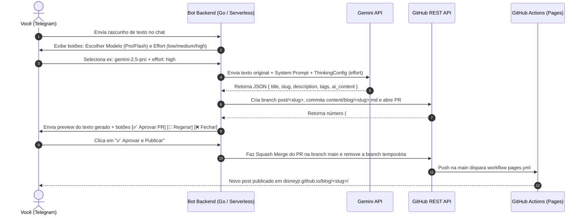

# Arquitetura da Integração: Telegram Bot + Gemini LLM + GitHub PR

Este documento especifica o funcionamento, o contrato de dados e o passo a passo de implementação do **Bot de Publicação do Blog via Telegram**, permitindo escrever um rascunho no celular, gerar a versão otimizada no **Google Gemini** (registrando o modelo e o nível de *effort*), visualizar o resultado no próprio Telegram e publicar no blog aprovando o Pull Request com um clique.

---

## 1. Visão Geral do Fluxo



---

## 2. Contrato do Arquivo Markdown no Repositório

Os templates do Hugo (`layouts/blog/single.html`, `layouts/blog/summary.html` e `layouts/index.html`) já estão preparados para ler os campos `ai_meta.model`, `ai_meta.effort` e `ai_content`.

Quando o Bot criar o commit na branch do Pull Request, ele deve gravar o arquivo `content/blog/<slug>.md` seguindo exatamente esta estrutura:

```yaml
---
title: "Título do Post"
date: "2026-11-08T20:30:00-03:00"
draft: false
description: "Resumo de 1 a 2 frases gerado para SEO e OpenGraph."
tags:
  - "Backend"
  - "Go"
  - ".NET"
ai_meta:
  model: "gemini-2.5-pro"
  effort: "high"
ai_content: |
  ## Introdução
  Conteúdo em Markdown gerado pela LLM com indentação de 2 espaços...
---

Texto original exatamente como você enviou no Telegram (ou com correções mínimas de formatação Markdown).
```

> **Importante sobre YAML Multiline (`ai_content: |`):**
> Todo o texto dentro de `ai_content` deve ser indentado com **2 espaços** em cada linha para manter o bloco YAML válido no Hugo.

---

## 3. Integração com a API do Gemini (Model & Effort)

### 3.1 Mapeamento de `effort` para a API do Gemini

Na API oficial do Gemini (`google.golang.org/genai` em Go ou `@google/genai` em TypeScript), o nível de esforço (*effort*) pode ser controlado via `ThinkingConfig`:

| Effort (`ai_meta.effort`) | Uso Recomendado | Configuração `ThinkingConfig` |
| :--- | :--- | :--- |
| **`low`** | Posts rápidos, notas curtas, resumos diretos | `ThinkingLevel: "LOW"` (ou `ThinkingBudget: 1024`) |
| **`medium`** | Artigos técnicos padrão, tutoriais práticos | `ThinkingLevel: "MEDIUM"` (ou `ThinkingBudget: 8192`) |
| **`high`** | Deep-dives de arquitetura, análises complexas | `ThinkingLevel: "HIGH"` (ou `ThinkingBudget: 24576`) |

### 3.2 System Prompt e Structured Output (JSON)

Para evitar erros de parsing, configure a chamada ao Gemini com `responseMimeType: "application/json"` e o seguinte schema de resposta:

```json
{
  "type": "object",
  "properties": {
    "title": { "type": "string", "description": "Título atraente para o post" },
    "slug": { "type": "string", "description": "Slug URL-safe em kebab-case (ex: por-que-back-end)" },
    "description": { "type": "string", "description": "Resumo SEO de até 155 caracteres" },
    "tags": {
      "type": "array",
      "items": { "type": "string" },
      "description": "Até 5 tags técnicas relevantes"
    },
    "ai_content": {
      "type": "string",
      "description": "Versão completa do artigo em Markdown (sem o título H1 principal, usando H2/H3, listas e exemplos de código quando aplicável)"
    }
  },
  "required": ["title", "slug", "description", "tags", "ai_content"]
}
```

**Prompt de Sistema Sugerido:**
> *"Você é um engenheiro de software sênior especialista em Backend (.NET, C#, Go, Microserviços e Arquitetura de Sistemas Distribuídos) atuando como co-autor técnico no blog de Disney Teixeira. A partir do rascunho autoral enviado pelo usuário, elabore uma versão expandida, bem estruturada e tecnicamente aprofundada em Markdown (`ai_content`), mantendo a essência e as opiniões do autor original, adicionando boas práticas, exemplos claros e subtítulos organizados."*

---

## 4. Integração com a API do GitHub (Branch → PR → Merge)

Utilizando um **Fine-Grained Personal Access Token (PAT)** do GitHub com permissão apenas no repositório `Disneyjr/Portifolio` (`Contents: Read & Write` e `Pull Requests: Read & Write`):

1. **Obter o SHA da `main`:**
   - `GET /repos/Disneyjr/Portifolio/git/ref/heads/main`
2. **Criar a nova branch (`post/<slug>`):**
   - `POST /repos/Disneyjr/Portifolio/git/refs`
   - Body: `{ "ref": "refs/heads/post/<slug>", "sha": "<main_sha>" }`
3. **Criar/Atualizar o arquivo `.md` na branch:**
   - `PUT /repos/Disneyjr/Portifolio/contents/content/blog/<slug>.md`
   - Body:
     ```json
     {
       "message": "feat(blog): adiciona post '<title>' [gemini-2.5-pro | effort: high]",
       "content": "<BASE64_DO_ARQUIVO_MD>",
       "branch": "post/<slug>"
     }
     ```
4. **Abrir o Pull Request:**
   - `POST /repos/Disneyjr/Portifolio/pulls`
   - Body:
     ```json
     {
       "title": "📝 Post: <title> (gemini-2.5-pro | high)",
       "head": "post/<slug>",
       "base": "main",
       "body": "Post gerado via Telegram Bot.\n- **Modelo:** `gemini-2.5-pro`\n- **Effort:** `high`"
     }
     ```
5. **Aprovar e Fazer Merge do PR (quando você clicar em `✅ Aprovar` no Telegram):**
   - `PUT /repos/Disneyjr/Portifolio/pulls/<pull_number>/merge`
   - Body: `{ "merge_method": "squash" }`
   - Em seguida, remover a branch temporária: `DELETE /repos/Disneyjr/Portifolio/git/refs/heads/post/<slug>`

---

## 5. Experiência e Comandos no Bot do Telegram

### Segurança (Whitelist)
O Bot deve verificar em **todas** as mensagens e callbacks se `update.Message.From.ID == TELEGRAM_ALLOWED_USER_ID`. Qualquer outro usuário recebe `403 Acesso restrito`.

### Fluxo Interativo no Chat
1. **Você envia uma mensagem de texto** (ou áudio transcrito) para o bot.
2. **Bot responde com Inline Keyboard:**
   - Linha 1 (Modelo): `[🤖 Gemini 2.5 Pro]` `[⚡ Gemini 2.5 Flash]`
   - Linha 2 (Effort): `[🟢 Low]` `[🔵 Medium]` `[🟣 High]`
   - Linha 3: `[🚀 Gerar e Abrir PR]`
3. **Após gerar e abrir o PR**, o Bot envia no Telegram:
   - Cabeçalho com `PR #15 aberto`, `Modelo: gemini-2.5-pro`, `Effort: HIGH` e link para o PR.
   - O texto gerado (`ai_content`) para você ler direto no celular (dividido automaticamente caso passe de 4096 caracteres do limite do Telegram).
   - Botões de decisão:
     - `[✅ Aprovar e Publicar (Merge PR)]` (`callback_data: "merge:<pr_number>:<slug>"`)
     - `[🔄 Regerar com outro Effort]` (`callback_data: "regen:<pr_number>:<slug>"`)
     - `[❌ Fechar PR]` (`callback_data: "close:<pr_number>:<slug>"`)

---

## 6. Opções de Hospedagem (Custo Zero)

| Opção | Stack | Vantagens |
| :--- | :--- | :--- |
| **Opção A (Recomendada para Portfólio)** | **Go (Golang)** no **Google Cloud Run** ou **Fly.io** | Escala a zero (custo R$ 0,00 via Webhook), usa a mesma linguagem principal do seu portfólio e pode ser um repositório público de destaque (`blog-telegram-bot-go`). |
| **Opção B (Serverless Edge)** | **TypeScript** no **Cloudflare Workers** + KV | Deploy em 5 segundos, 100.000 requisições/dia grátis, KV gratuito para guardar o rascunho enquanto você escolhe o `effort` nos botões. |

### Variáveis de Ambiente Necessárias
```env
TELEGRAM_BOT_TOKEN=123456:ABC-DEF...
TELEGRAM_ALLOWED_USER_ID=seu_id_numerico_do_telegram
GEMINI_API_KEY=AIzaSy...
GITHUB_TOKEN=github_pat_...
GITHUB_OWNER=Disneyjr
GITHUB_REPO=Portifolio
```
